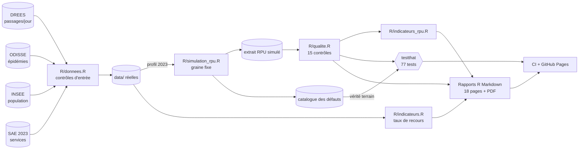

# Activité des urgences en Hauts-de-France (R / R Markdown)

[](https://github.com/valentinratigniet-byte/projet-23-urgences-hdf-r/actions/workflows/ci.yml)
  

**Rapports en ligne : https://valentinratigniet-byte.github.io/projet-23-urgences-hdf-r/**

Indicateurs d'activité des urgences, contrôle qualité des données RPU et restitution aux décideurs, en
R du téléchargement des sources jusqu'aux rapports paramétrés, testé et publié par la CI.

## Contexte

Un observatoire régional des urgences a trois missions : produire des indicateurs d'activité, aider les
établissements à fiabiliser les données qu'ils transmettent (les RPU, un résumé par passage), et restituer
aux décideurs (ARS, équipes de terrain). Ce projet couvre les trois sur les 5 départements des
Hauts-de-France.

| Mission | Livrable |
|---|---|
| Indicateurs d'activité | [Panorama régional](https://valentinratigniet-byte.github.io/projet-23-urgences-hdf-r/panorama.html) (volumes, taux de recours, saisonnalité, épidémies) et 5 rapports départementaux paramétrés (`params: dep`) ; [indicateurs issus des RPU](https://valentinratigniet-byte.github.io/projet-23-urgences-hdf-r/activite_rpu.html) (durée de passage, hospitalisation, gravité, âge, heures d'arrivée) |
| Qualité des données | [Services d'urgence réels (SAE 2023)](https://valentinratigniet-byte.github.io/projet-23-urgences-hdf-r/etablissements_sae.html) : rapprochement avec la DREES, complétude des déclarations ; 8 rapports par établissement paramétrés (`params: finess`, extrait simulé) : 4 critères de qualité, score, actions prioritaires, passages à corriger |
| Restitution | [Note d'une page en PDF](https://valentinratigniet-byte.github.io/projet-23-urgences-hdf-r/note_ars.pdf) : 3 constats chiffrés, 1 limite, 1 recommandation |

## Résultats (données réelles DREES)

| Constat | Chiffre |
|---|---|
| Passages aux urgences en 2023 (5 départements) | **1,99 million**, soit 5 451 par jour |
| Évolution 2019-2023 de la région | **-2,5 %** (France : -6,1 %) |
| Chute de 2020 (Covid) | -21 % |
| Pas-de-Calais / Oise, 2019-2023 | **+8,1 %** (seul département au-dessus de 2019) / -7,4 % |
| Taux de recours 2023, pour 10 000 habitants | **3 320** en région (France : 3 048) ; de 3 079 (Oise) à 4 060 (Aisne) |
| Pas-de-Calais en 2019 | taux le plus bas de la région (2 917) : sa hausse est en partie un rattrapage |
| Services d'urgence (SAE 2023) | **64** dans 49 établissements ; la somme de leurs passages retrouve le total DREES à 1 passage près par département |
| Déclarations SAE incomplètes | **22 services sur 64** ne déclarent pas leurs hospitalisations ; 21 % de passages hospitalisés dans les 42 autres |
| Lundi par rapport à une journée moyenne | **+10 %** ; 9 des 10 journées les plus chargées sont des lundis |

## Données

| Source | Contenu | Statut |
|---|---|---|
| DREES, [séries longues des passages aux urgences 2017-2023](https://data.drees.solidarites-sante.gouv.fr/explore/dataset/series_longues_passages_urgences_2017_2023/) | passages quotidiens par département | **réelles**, valeurs journalières **estimées** (RPU calés sur les totaux annuels de la SAE) |
| Santé publique France, ODISSE | taux hebdomadaires grippe, gastro-entérite, bronchiolite pour 100 000 passages | **réelles**, à partir de 2021 seulement (fin 2019 pour la bronchiolite) |
| INSEE, [estimations de population au 1er janvier](https://www.insee.fr/fr/statistiques/8721456) | population par département, 2017-2023 | **réelles** (édition du 23/12/2025) |
| DREES, [SAE 2023, base administrative](https://data.drees.solidarites-sante.gouv.fr/explore/dataset/707_bases-administratives-sae/) | par service d'urgence : passages, dont 80 ans et plus, moins de 18 ans, hospitalisés | **réelles**, déclarées par les établissements |
| Etalab, [contours administratifs](https://www.data.gouv.fr/fr/datasets/contours-administratifs/) | contours des 5 départements (carte) | d'après OpenStreetMap, licence ODbL |
| Extrait RPU 2023, 8 établissements | 16 champs du format national V2006 (naissance, entrée, provenance, transport, CCMU, DP, sortie, destination, orientation…) | **simulé** : les RPU réels sont confidentiels |

Les sources DREES, Santé publique France et INSEE sont sous Licence Ouverte 2.0 ; les contours, sous ODbL. La série « France » est la somme des 93 départements
dont la série couvre toute la période : la Corse, le Territoire de Belfort et La Réunion (à partir de 2018) et
la Guyane (à partir de 2020) sont exclus, sinon leur arrivée créerait une fausse hausse. Le taux de recours
rapporte les passages d'un département à sa population, sans corriger les déplacements de patients entre
départements.

## Un contrôle qualité vérifiable

L'extrait RPU simulé (163 945 passages) suit le vrai profil quotidien 2023 de chaque département. Ses champs
et nomenclatures suivent le format national V2006 et les [règles de codage de la FEDORU](https://fedoru.fr/wp-content/uploads/2022/03/2_GT1_V02_Format_des_elements_collectes_et_regles_de_codage.pdf),
dont les règles de cohérence entre champs : provenance selon le mode d'entrée, destination et orientation
selon le mode de sortie, dispense de diagnostic pour un patient parti sans attendre. Il contient
**15 types de défauts injectés** (diagnostic vide ou hors format CIM-10, destination manquante, orientation
contraire au mode de sortie, sortie avant l'entrée, doublons, jours non transmis…), avec des profils
d'établissement différents. Chaque défaut est inscrit dans un [catalogue](docs/catalogue_defauts.md) qui
sert de vérité terrain. Un test vérifie que les contrôles retrouvent **exactement les 24 757 défauts
injectés**, sans manque ni excès.

Ce test a trouvé des bugs dans le générateur lui-même : des « décès en CCMU 1 » posés sur des passages qui
n'étaient pas en CCMU 1, et des heures d'arrivée calculées en UTC qui faisaient glisser des passages du
31 décembre au 1er janvier 2024. Il a aussi fait apparaître un vrai piège des RPU : la nuit du passage à
l'heure d'hiver, l'heure 02:xx existe deux fois, et une sortie à 02:10 après une entrée à 02:25 se relit
comme une sortie avant l'entrée. La lecture corrige ce cas, et lui seul.

Les [indicateurs issus des RPU](https://valentinratigniet-byte.github.io/projet-23-urgences-hdf-r/activite_rpu.html) (durée médiane de passage, part au-delà de 4 h,
hospitalisation, CCMU, âges extrêmes, arrivées de nuit) n'utilisent que les passages où le champ concerné
est exploitable, et publient la part écartée : jusqu'à 6,1 % des passages pour la gravité dans les
établissements de qualité faible. Calculés sur l'extrait simulé, ils montrent la méthode, pas une réalité.

| Établissement (fictif) | Score | Ce qui le pénalise |
|---|---|---|
| SIM60A | 86,9 | diagnostic exploitable dans 62,6 % des passages seulement |
| SIM62B | 97,0 | 17 jours non transmis (objectif d'exhaustivité : 100 %) |
| SIM59A, SIM02A | 99,6 | meilleurs scores |

## Architecture

**[Ouvrir le schéma interactif](https://valentinratigniet-byte.github.io/projet-23-urgences-hdf-r/architecture.html)** (zoom, recherche, suivi des flux, export PNG/SVG ; chaque bloc renvoie aux lignes de code). Généré avec [Archify](https://github.com/tt-a1i/archify) depuis [`docs/architecture.archify.json`](docs/architecture.archify.json).



## Structure

```
R/donnees.R          téléchargement DREES, ODISSE, INSEE, SAE, contours ; contrôles d'entrée bloquants
R/simulation_rpu.R   générateur RPU reproductible (graine fixe) + injection tracée des défauts
R/qualite.R          lecture RPU, 15 contrôles, score par établissement, actions prioritaires
R/indicateurs.R      passages annuels, taux de recours, saisonnalité, pics, épidémies, indicateurs SAE
R/indicateurs_rpu.R  durées de passage, hospitalisation, CCMU, âges, heures d'arrivée, part écartée
rapports/            panorama (avec carte), departement (params: dep), etablissements_sae, qualite (params:
                     finess), activite_rpu, note_ars
scripts/             01_donnees.R, 02_simuler_rpu.R, 03_rapports.R, tests.R
tests/testthat/      77 tests
```

## Lancer le projet

```r
renv::restore()                     # versions figées (renv.lock)
source("scripts/01_donnees.R")      # facultatif : données réelles déjà versionnées dans data/
source("scripts/02_simuler_rpu.R")  # régénère l'extrait simulé (identique, graine fixe)
source("scripts/tests.R")           # 77 tests
source("scripts/03_rapports.R")     # 18 rapports dans site/ (environ 10 min)
```

La note PDF est imprimée par Chrome headless, ce qui évite d'installer LaTeX. Sous Windows, si `pandoc`
n'est pas dans le PATH, le script utilise celui de RStudio.

La CI (GitHub Actions, `r-lib/actions`) restaure renv, lance les tests et vérifie que la simulation régénérée
est identique au fichier versionné. Elle rend ensuite les 18 rapports et les publie sur GitHub Pages.

## Limites

- Les volumes journaliers sont estimés : solides pour les tendances et la saisonnalité, pas pour lire une journée isolée.
- Le taux de recours ne corrige pas les déplacements de patients entre départements.
- Les épidémies ne sont observables que de 2021 à 2023, et le lien avec les passages est une corrélation.
- L'extrait RPU est simulé : il illustre la méthode, pas la situation réelle d'un établissement. L'exhaustivité
  des RPU par rapport à la SAE, indicateur clé d'un observatoire, demande les RPU réels par établissement,
  qui ne sont pas publics.

---

Projet de portfolio, sans lien avec un organisme officiel. Code sous licence MIT.
